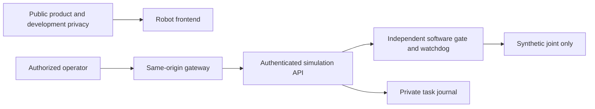

# Onesa Robot

Canonical repository: [DruHustle/onesa-robot](https://github.com/DruHustle/onesa-robot).
The repository was renamed from `onesa-ai-robot`. Existing component directories
(`onesa-ai-robot-frontend` and `onesa-ai-robot-backend`), hosting resource names,
runtime installation paths and historical release evidence retain their identifiers
so this repository rename does not require a service or data migration.

The current source adds a supervised **Pump P-101 inspection**: versioned bounded
planning and skills, exact-plan password approval, deterministic scenarios,
traceable reports, owned JSON exports and command-free replay. Optional read-only
AI asset-context file import stays disabled by default. Use the
[local inspection demonstration](docs/engineering/ENGINEERING_ONBOARDING.md#demonstrate-an-industrial-inspection-locally).
This source capability has separate CI/hosted release gates; the accepted production
component identities below remain authoritative until new acceptance is recorded.

Node application startup has a narrowly scoped CA trust policy, with isolated
regressions in `node --test scripts/test_tls_trust.mjs`. Use Node 24.12+ in the 24
series. Source implementation is separate from the accepted component releases
recorded below; no production update follows merely from merging source.

Journal transport preserves finite numeric values through decimal text and explicit
SQLite REAL conversion. History reads use a lossless text projection before exact
comparison; schema checks, ownership fences and bounded recovery remain enforced.
This source correction is not evidence of a deployed recovery or a history rewrite.

Production API hosting moved to the existing Oracle Free VM on 2026-10-16; the
Vercel frontend and existing data services remain. See the
[verified hosting cutover](docs/engineering/DEPLOYMENT.md)
for source identities, protected ingress, acceptance and rollback.

Onesa UG's robotics software development line. The current production scope is an
**authenticated software simulator**: propose a synthetic joint movement, confirm
operator approval, inspect task history, cancel or stop, and test safe failure behavior.
Physical actuators, connected ROS nodes, cameras and real STT/VLM/TTS/VLA models are
not implemented. Simulation results do not certify physical robot safety.

The current source also includes a protected 33-axis full-body humanoid reference
with simulated actuators, exact-plan operator confirmation, coordinated limit checks,
dedicated supervision and URDF export. Its bounded history is process-local; no
physical driver or balance/contact model is present. See the
[simulation architecture](docs/engineering/SIMULATION_ARCHITECTURE.md#full-body-humanoid-reference--source-development)
for the development scope and authority boundary. Hosted acceptance is separate.

**Under development.** Protected operator access supports authorized development
and testing. Essential sign-in sessions, operator-linked synthetic task history and
security diagnostics support that purpose. The owner has deferred the corresponding
privacy approval records until launch; that decision is not a legal certification.
See the [scoped development release procedure](docs/engineering/DEPLOYMENT.md).

Latest accepted frontend `09cdae669a8a3f2cf74cc0602c38d42ab679df78`, Vercel
`dpl_HcTeqGXv8XH6HWgn9jEwZnJgwsWv`, serves `https://robot.onesa.eu/`.
Oracle backend `4f5e6c56f6b81f87e4326cf7cd6f956b91d79107` is qualified under
that exact main revision. Full required main CI passes. The affected staging
qualification passes 14 API checks and five synthetic numeric-transport checks;
all 1,321 earlier staging records are preserved with three owned terminal test tasks.
Browser runtime, product images/CSS and application dependencies are unchanged;
prior 111-case browser acceptance remains separately source-bound evidence.
Production acceptance verifies seven readiness samples, protected operator
read-only history/sign-in/logout, six private-route denials and all 78 unchanged
history records. Credentials and the eight other services are preserved.
The journal fix preserves exact floating-point values across the remote protocol;
Node and certifi trust-store checks pass. Bounded fenced idle recovery never
resumes tasks or physical operation. The historical network-timeout cause remains
unproven, and a single VM does not guarantee future availability. No production
tasks, account/password changes or physical operation accompanied this release. See
[CHANGELOG.md](CHANGELOG.md) for accepted components and limits.


The public [Robot product](https://robot.onesa.eu) explains that scope. The operator
console serves protected simulation data through an independently authenticated API;
an ordinary Onesa AI account grants no Robot operator permission. In the earlier
2026-10-15 release, frontend and backend source
`595fd4f494e77de4fdecacbb9e64ac46c8c3597b` passed exact-main CI, hosted staging
(16 API/safety checks and 96 browser cases), current owner authorization and production
acceptance on 2026-10-15. Production verification passed 14 API/safety/administrator
checks, two public layouts, anonymous console isolation and six private-data denials.
All 73 pre-existing history records and credentials were preserved; three owned synthetic
acceptance records are accounted for. The service finished stopped/idle with no connected
controller or physical actuation. Current receipts and earlier failed observations are
recorded in [CHANGELOG.md](CHANGELOG.md) and [the protected deployment guide](docs/engineering/DEPLOYMENT.md).
Local or later source changes require their own applicable release verification.



| Component | Technology | Local guide |
| --- | --- | --- |
| `onesa-ai-robot-frontend/` | Static HTML/CSS, generated TypeScript client, Node 24 proxy | [Frontend](onesa-ai-robot-frontend/README.md) |
| `onesa-ai-robot-backend/` | Python 3.11, FastAPI, local private SQLite; cloud Turso journal | [Backend](onesa-ai-robot-backend/README.md) |
| `edge/` and `ros2/` | Optional synthetic telemetry; preparatory ROS 2 Jazzy messages | [ROS boundary](ros2/README.md) |
| `docs/engineering/` | Architecture, tests, onboarding and release procedures | [Start here](docs/engineering/ENGINEERING_ONBOARDING.md) |

Use Python 3.11 and Node 24. For the smallest local setup, install the backend's
hash-locked development requirements into a virtual environment, generate a private
operator password hash, and configure an ignored environment file from its
`.env.example`. Use a private local SQLite path and `http://localhost:3431` as the
public origin. The [backend guide](onesa-ai-robot-backend/README.md) gives the exact
factory startup command without cloud credentials. In another terminal:

```sh
cd onesa-ai-robot-frontend
npm ci --ignore-scripts
npm run build
ROBOT_API_URL=http://127.0.0.1:8431 npm start
```

Open `http://localhost:3431` for product information and `/console` for operator sign-in.
The product is **pre-launch, under development**, with **protected access for
authorized users**. To exercise the new administration software locally, explicitly
set `ROBOT_ADMINISTRATOR_NAME` to the configured `ROBOT_OPERATOR_NAME`; leaving it
empty grants no administrator role. The designated administrator can allow or block
physical-operation permission after password confirmation. The console separately
shows connection, readiness and actual operation: hardware is still being developed,
so allowing permission does not connect a controller or start movement. Permission
belongs to the issuing session and is revoked on logout, expiry, restart or Stop.
It is not stored in the simulation task journal and never replays existing tasks.
The simulator starts stopped. Reset requires operator confirmation and never resumes
an old task. No sibling repository, paid inference, cloud database or physical robot
is required for this local path.

Run backend lint/types/tests and frontend build/types/unit/browser checks using
[Build and Test](docs/engineering/BUILD_AND_TEST.md). Browser tests use an isolated
simulator and synthetic credentials. They cover system-light/dark appearance, live
preference changes, keyboard access and safe operator flows. Appearance follows the
browser/OS; there is no appearance selector, stored override or clock schedule.
Shared Onesa foundations are version-pinned while Robot retains its teal engineering
identity and dedicated operational shell.
Console sign-in performs bounded readiness checks before submitting credentials;
temporary unavailability retains masked entries for an explicit retry. The initial
anonymous session lookup preserves a password entered before submission; explicit
rejection, logout and later session expiry still clear passwords. Versioned
Robot SVG/ICO/touch icons preserve approved Onesa artwork and distinct product identity.

The permanent branches are **dev**, **staging** and **main**. Normal contributions
follow **dev → staging → main**, with exact-source CI, hosted staging,
qualification and the current owner-authorized release process. See
[engineering policies](AGENTS.md), [onboarding](docs/engineering/ENGINEERING_ONBOARDING.md)
and [deployment](docs/engineering/DEPLOYMENT.md). GitHub Free conventions do not prove
server-enforced branch protection. The repositories retain independent deployment,
authentication and data boundaries. The existing release workflow supports an explicit,
strictly verified frontend-only release that retains an unchanged qualified backend;
it still requires fresh hosted staging and owner authorization. Temporary Dependabot security PRs and necessary
security release candidates are allowed under the documented security procedure; they
do not authorize automatic merges or production releases. Ordinary version PRs stay disabled.

[Onesa Developer Docs](https://docs.onesa.eu) contains approved public material.
Detailed engineering, release evidence and operational instructions require authorized
internal access; sensitive records and credentials stay outside documentation builds.

Report suspected vulnerabilities privately to [info@onesa.eu](mailto:info@onesa.eu)
or GitHub private vulnerability reporting when available. Provide affected version,
impact and a minimal safe reproduction; do not post sensitive details publicly or send
passwords, customer records or exploit payloads. Support is limited to the latest
reviewed main revision. No historical-support promise, bounty or response SLA is asserted.

Maintained by Onesa UG (haftungsbeschränkt), Heidelberg, Germany. No project license
has been approved; open-weight models or dependency licenses do not make this
repository open-source. Preserve all third-party licenses and notices.
