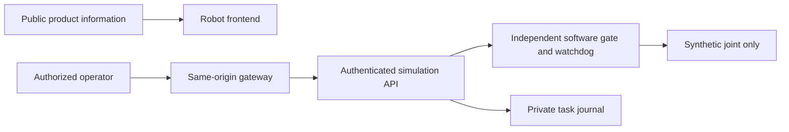

# Onesa AI Robot

Onesa UG's robotics software development line. The current production scope is an
**authenticated software simulator**: propose a synthetic joint movement, confirm
operator approval, inspect task history, cancel or stop, and test safe failure behavior.
Physical actuators, connected ROS nodes, cameras and real STT/VLM/TTS/VLA models are
not implemented. Simulation results do not certify physical robot safety.

The public [Robot product](https://robot.onesa.eu) explains that scope. The operator
console serves protected simulation data through an independently authenticated API;
an ordinary Onesa AI account grants no Robot operator permission. Production source
56ce52f frontend with retained 1638108 backend passed the 13 API/safety checks;
hosted acceptance remains blocked after one WebKit sign-out failure and subsequent
fail-closed journal unavailability. The current result and earlier
October 13 recovery baseline are recorded in [CHANGELOG.md](CHANGELOG.md) and
[the protected deployment guide](docs/engineering/DEPLOYMENT.md). Changes in a local
checkout need their own qualification before deployment.



| Component | Technology | Local guide |
| --- | --- | --- |
| `onesa-ai-robot-frontend/` | Static HTML/CSS, generated TypeScript client, Node 24 proxy | [Frontend](onesa-ai-robot-frontend/README.md) |
| `onesa-ai-robot-backend/` | Python 3.11, FastAPI, local private SQLite; cloud Turso journal | [Backend](onesa-ai-robot-backend/README.md) |
| `edge/` and `ros2/` | Optional synthetic telemetry; preparatory ROS 2 Jazzy messages | [ROS boundary](ros2/README.md) |
| `docs/engineering/` | Architecture, tests, onboarding and release procedures | [Start here](docs/engineering/ENGINEERING_ONBOARDING.md) |

Use Python 3.11 and Node 24. For the smallest local setup, install the backend's
hash-locked development requirements into a virtual environment, generate a private
operator password hash, and configure an ignored environment file from its
`.env.example`. Use a private local SQLite path and `http://localhost:3431` as the
public origin. The [backend guide](onesa-ai-robot-backend/README.md) gives the exact
factory startup command without cloud credentials. In another terminal:

```sh
cd onesa-ai-robot-frontend
npm ci --ignore-scripts
npm run build
ROBOT_API_URL=http://127.0.0.1:8431 npm start
```

Open `http://localhost:3431` for product information and `/console` for operator sign-in.
The simulator starts stopped. Reset requires operator confirmation and never resumes
an old task. No sibling repository, paid inference, cloud database or physical robot
is required for this local path.

Run backend lint/types/tests and frontend build/types/unit/browser checks using
[Build and Test](docs/engineering/BUILD_AND_TEST.md). Browser tests use an isolated
simulator and synthetic credentials. They cover system-light/dark appearance, live
preference changes, keyboard access and safe operator flows. Appearance follows the
browser/OS; there is no appearance selector, stored override or clock schedule.
Shared Onesa foundations are version-pinned while Robot retains its teal engineering
identity and dedicated operational shell.
Console sign-in performs bounded readiness checks before submitting credentials;
temporary unavailability retains masked entries for an explicit retry. Versioned
Robot SVG/ICO/touch icons preserve approved Onesa artwork and distinct product identity.

The permanent branches are **dev**, **staging** and **main**. Normal contributions
follow **dev → staging → main**, with exact-source CI, hosted staging,
qualification and the current owner-authorized release process. See
[engineering policies](AGENTS.md), [onboarding](docs/engineering/ENGINEERING_ONBOARDING.md)
and [deployment](docs/engineering/DEPLOYMENT.md). GitHub Free conventions do not prove
server-enforced branch protection. The repositories retain independent deployment,
authentication and data boundaries. The existing release workflow supports an explicit,
strictly verified frontend-only release that retains an unchanged qualified backend;
it still requires fresh hosted staging and owner authorization. Temporary Dependabot security PRs and necessary
security release candidates are allowed under the documented security procedure; they
do not authorize automatic merges or production releases. Ordinary version PRs stay disabled.

[Onesa Developer Docs](https://docs.onesa.eu) contains approved public material.
Detailed engineering, release evidence and operational instructions require authorized
internal access; sensitive records and credentials stay outside documentation builds.

Report suspected vulnerabilities privately to [info@onesa.eu](mailto:info@onesa.eu)
or GitHub private vulnerability reporting when available. Provide affected version,
impact and a minimal safe reproduction; do not post sensitive details publicly or send
passwords, customer records or exploit payloads. Support is limited to the latest
reviewed main revision. No historical-support promise, bounty or response SLA is asserted.

Maintained by Onesa UG (haftungsbeschränkt), Heidelberg, Germany. No project license
has been approved; open-weight models or dependency licenses do not make this
repository open-source. Preserve all third-party licenses and notices.
