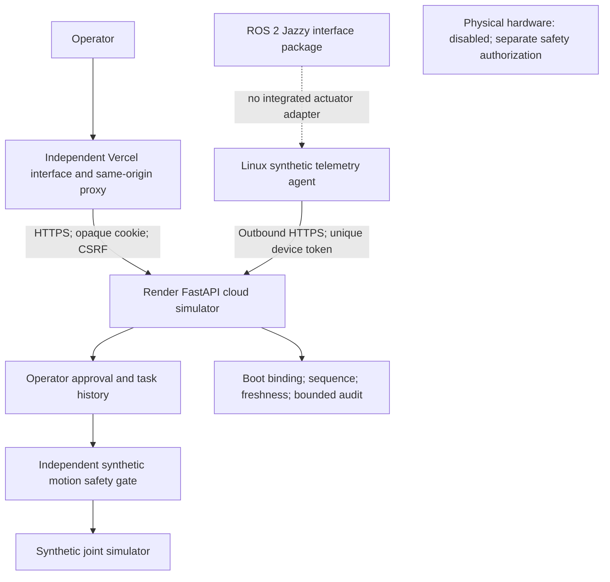

# Robot cloud and edge release qualification

> Current private-Free release policy: [safeguards and external owner authorization](../development/PRIVATE_FREE_SAFEGUARDS.md). Legacy JSON approval is retired; native protection requirements below apply only to a verified supported configuration.

The implemented product is a static JavaScript/typed-client operator interface and
FastAPI software simulator. The directory is `onesa-ai-robot-frontend`, despite the
logical product name “robot interface”. No directory rename, framework rewrite or
sibling repository dependency is required. Python 3.11 and Node 24 remain the runtimes.

Cloud commands operate a synthetic joint inside the existing independent safety gate.
A separate outbound edge client sends **telemetry only**; it has no command receiver.
ROS interface compilation/discovery tests do not establish a cloud-to-ROS action adapter.
Physical operation always rejects startup. Camera/perception/model adapters, multi-user
RBAC and real actuator controllers are not implemented and are not claimed as verified.

## Workflows and evidence

| Workflow | Purpose |
| --- | --- |
| `scaffold.yml` | Existing frontend/backend/browser/accessibility/security jobs plus backend mypy and isolated ROS Jazzy interface compile/message test |
| `repository-hygiene.yml` | Existing publication/privacy gate |
| `release-staging.yml` | Owner dispatch current main: exact CI, isolated targets, protected Preview, exact Render commit, synthetic API/safety/device/browser acceptance |
| `release-build.yml` | Protected main production prebuilt build, encrypted with a private AES-256-GCM key; no publication |
| `release-qualification.yml` | Automatically collect immutable GitHub artifacts and exact source/run/build provenance |
| `release-review.yml` | Explicit owner operations and content/legal review, or revoke; binds evidence digest and open owner issue/PR |
| `deploy.yml` | Owner-dispatched approved simulation cloud promotion; recheck staging, restore reviewed frontend artifact, exact backend source, acceptance |
| `robot-edge-release.yml` | Protected-main owner distribution review, versioned simulator container and ROS/telemetry-agent source candidate, fresh image scan; no installer or registry publication |
| `robot-monitor.yml` | After successful cloud deployment: verify latest provider commit and current readiness; no repair/promotion |
| `release-candidate.yml` | Existing independent application packaging retained |

PR CI detects paths without external Actions dependencies. Frontend-only changes
skip backend/ROS rebuilding; backend schema/safety or shared scripts/contracts trigger
frontend checks as well. Every main push and manual CI dispatch runs the complete
release set, including both runtime digest artifacts. Skipped or absent exact-commit
checks cannot qualify a release. Before merging a dev-to-staging PR, dispatch full CI on its SHA when path-filtered push jobs
leave a required context absent. Exact main release checks always run in full.
Main protection requires the existing checks plus
`ros-contracts`; workflows never infer success from a skipped job.

Generated qualification includes repository, candidate SHA, source fingerprint,
CI jobs/security/image digests, production prebuilt artifact IDs/hashes, staging
provider IDs, tested flows, source/content version and explicit approval provenance.
GitHub run/repository/workflow/event/attempt and immutable ZIP digests are validated;
PR artifacts are never executed. Evidence and approvals expire after 24 hours.
A newer pending/failed/revoked review or a closed owner review record blocks promotion.
Artifacts retain seven days; provider files, plaintext builds, credentials and raw
browser/security reports are excluded. Render rebuilds the exact source; binary
identity with the locally scanned Docker image is not claimed.

`CODE_VERIFIED`, `STAGING_VERIFIED`, `OPERATIONS_VERIFIED` and
`CONTENT_LEGAL_APPROVED` remain distinct. Technical CI derives
`SIMULATION_VERIFIED`, `ROBOT_SAFETY_SOFTWARE_VERIFIED` and
`ROS2_INTERFACE_VERIFIED`. `ROS2_VERIFIED` (integrated robotics runtime) and
`EDGE_DEPLOYMENT_VERIFIED` remain NOT TESTED. `PHYSICAL_HARDWARE_APPROVED`
and `PHYSICAL_HARDWARE_READY` remain BLOCKED even after a cloud approval.
Operations/legal gates require real evidence and current scope-specific owner authority;
reuse recorded authorization when applicable without fabricating new review. No physical PASS is generated.
Robot had no legacy `RELEASE_QUALIFICATION_JSON` deploy gate; no secret is removed.
The sibling products have retired their legacy JSON fallback; private Free uses external owner authorization.

The added development-only mypy 2.4.0 and hash-locked dependencies were obtained
from PyPI and checked against installed package metadata: mypy/mypy-extensions,
ast-serialize and librt declare MIT; pathspec declares MPL-2.0. Runtime dependency
locks are unchanged. No project license is assigned by adding these development tools.

## Owner activation and secret locations

In this repository's **Settings → Environments**, create `Staging` and protect it
and `Production` with supported reviewers and main-only deployment policies. Activate
and read back the prepared main policy. Read-only inspection on 2026-10-11 found main
unprotected and Preview/Production without reviewers or branch policies. No remote
setting was changed. Public GitHub Free supports environment approval controls;
private Free needs a separately reviewed secure runner/approval mechanism before this
pipeline can be activated. No local runner is registered by these changes.

Put the following values in the appropriate GitHub **environment secrets/variables**,
not in source files or chat. Prefix staging names exactly as shown; production removes
`STAGING_`. Independent staging projects/services must not reuse production IDs/data.

| Setting | Obtain/configure |
| --- | --- |
| `STAGING_RENDER_API_KEY` | Render account API key scoped to the approved robot staging resources |
| `STAGING_RENDER_SERVICE_ID` | ID of the isolated existing Render web service; no service has been provisioned by this change |
| `STAGING_VERCEL_PROJECT_ID` | Separate staging project Settings → General; root `onesa-ai-robot-frontend` |
| `VERCEL_ORG_ID`, `VERCEL_TOKEN` | Vercel account/team ID and privately generated account token |
| `STAGING_VERCEL_AUTOMATION_BYPASS_SECRET` | Staging Vercel Deployment Protection automation bypass; keep Preview protected |
| `STAGING_ROBOT_TEST_PASSWORD` | Private synthetic operator password; generate its scrypt hash with the existing backend security utility |
| `STAGING_ROBOT_EDGE_TOKEN` | Privately generate 32 random bytes as hex; store only its SHA256 hash in Render |
| `RELEASE_BUILD_KEY` (Production secret) | Privately generate an independent 32-byte hex encryption key; never reuse provider/device/password values |
| `STAGING_ROBOT_API_URL` (variable) | Actual credential-free HTTPS URL read from the authorized Render service |
| `STAGING_ROBOT_PUBLIC_ORIGIN` (variable) | Approved initial Preview origin; workflow binds the verified deployment origin before Render restart |
| `STAGING_ROBOT_TEST_OPERATOR` (variable) | Dedicated synthetic operator name matching Render; no real user data |
| `STAGING_ROBOT_EDGE_DEVICE_ID` (variable) | Dedicated `synthetic-…` identity matching Render; do not run a competing agent during acceptance |

In **Vercel project → Settings → Environment Variables**, configure server-only
`ROBOT_API_URL` for Preview to match isolated staging Render. Use Production for its
separate target. Never prefix it with a public/client environment prefix. Root directory,
project/repository linkage, API origin and Preview protection are read back before deploy.
CLI commands run from repository root, respecting Vercel's configured root directory.
Production authentication/browser checks use the configured canonical public origin
only after Vercel confirms it serves the same exact deployment as the returned
deployment URL. This preserves exact-Origin CSRF checks on custom domains.
Native Git deployments remain disabled in `vercel.json`.

In **Render service → Environment**, configure the settings in `render.yaml`:
`ROBOT_OPERATOR_NAME`, `ROBOT_OPERATOR_PASSWORD_HASH`, exact `ROBOT_PUBLIC_ORIGIN`,
`ROBOT_EDGE_DEVICE_ID`, `ROBOT_EDGE_TOKEN_SHA256`,
`ROBOT_DATABASE_PATH=/app/storage/robot.sqlite3`, `ROBOT_ACTUATION_ENABLED=false`,
`ROBOT_DEPLOYMENT_ENVIRONMENT=staging`, `ROBOT_STORAGE_MODE=ephemeral-simulation`.
Use Docker, root `onesa-ai-robot-backend`, main, auto-deploy off. The existing non-root
container uses one watchdog-owning process, `0.0.0.0` and Render's `PORT`.
The Blueprint is a reviewed staging template, not a deployment performed here.

## Storage and production blocker

The owner's 2026-10-13 decision selects the existing separate production Turso
database. Follow [the production binding and credential-isolation procedure](DEPLOYMENT.md#owner-selected-production-turso-journal--2026-10-13).
The provider guard now accepts the identified Free Frankfurt native runtime only
with that exact durable remote binding and credentials distinct from staging.
Actual production operations and deployment evidence remain required. The historical
SQLite limitation below remains applicable to filesystem storage on Render Free.

Render Free has an ephemeral filesystem and cannot attach a persistent disk. The
staging deployment explicitly labels disposable simulation history and uses synthetic
accounts/data only. A healthy process does not establish durable audit storage.
Production settings reject `ephemeral-simulation`; provider preflight also blocks
promotion without an approved persistent storage architecture. Under the current
free-only policy, the existing SQLite Render production path **cannot pass**.
No paid disk is provisioned and neither sibling product's database is reused.

Owner decision: qualify a separate free durable robot database/service boundary or
an approved persistent Linux host, then implement/test that storage adapter and
update the provider policy through normal review. Monitoring/simulation cloud
production and physical operation are separate decisions. No production URL is invented.

After owner-authorized branch push/PR/merge, inspect full main CI. Dispatch isolated
staging and inspect actual acceptance artifacts. Resolve storage/protection blockers
before production build/qualification/review. Select the exact staging run when generating
qualification; approve its canonical evidence digest with explicit operations/legal
review; dispatch production using the latest `approval_run`. Do not enable a gate
based only on local mocked tests. Hosted run/target acceptance is still NOT RUN.

## Acceptance, monitoring and recovery

Staging checks login/secure cookies, CSRF and unauthorized access, stop/reset,
proposal, safety denial, stale commands, UUID replay, completion, cancellation,
authority loss/reconnect, task audit, simulated device identity and stale telemetry,
and all browser/accessibility tests. Tests never interpret synthetic success as physical
readiness. The isolated software tests additionally exercise watchdog expiry, restart,
persistence, session ownership/revocation, sensor-value validation and safe transitions.

Post-deployment acceptance requires provider IDs and exact SHA, latest Render deployment,
ready database/watchdog, actual API flows and browsers. Follow-up monitoring observes
current provider identity/readiness. It does not claim continuous alert coverage or
inspect private log content automatically. Owner operations review must name alert
recipients, retention, provider build/runtime-log review, rate/concurrency limits,
backup restore evidence and a tested rollback candidate. Failed Actions/provider runs
remain failed; no auth/safety bypass, telemetry substitution or automatic retry is used.
Remediation is at most three attempts per issue through an explicitly authorized branch;
external configuration/hardware/spending decisions stop remediation.

Rollback is operator-controlled: stop simulation, revoke sessions, record current
provider IDs/SHA, back up SQLite consistently on a qualified durable host, verify the
previous independently approved frontend/backend pair and its compatible contract,
then redeploy that reviewed revision under fresh authorization. Restore a backup only
on an isolated test host first. Preserve history/stop latch; never restore execution
authority or replay commands. Ephemeral staging data is expendable and is not a backup.
No workflow installs software on a physical robot.

## Cross-repository isolation and remaining work

| Repository | Frontend | Backend | Current local automation status |
| --- | --- | --- | --- |
| Company Portal | Vercel; existing frontend root | Render API/worker | Existing qualification, review, staging, deployment workflows preserved |
| AI Platform | Vercel; existing frontend root | Render API | Existing qualification, review, staging, deployment workflows preserved |
| AI Robot | Vercel; `onesa-ai-robot-frontend` | Render cloud simulator; `onesa-ai-robot-backend` | Added staging/review/build/deploy/monitor gates; hosted targets pending |

Each repository has its own branch, artifacts, credentials, CI and release. No workflow
checks out or deploys a sibling repository. Robot does not yet call AI Platform APIs;
a future integration needs versioned authentication/API compatibility acceptance before
separate rollout. Current typed HTTP schemas include edge telemetry. ROS contracts are
simulation-only and keep public DDS/ROS/control/inference administration off the internet.

Priorities: (1) review/push through authorized PR and activate main/environment protections;
(2) configure isolated robot staging targets, synthetic credentials and prove hosted
acceptance; (3) approve a free durable production storage architecture and qualify
backup/recovery/log/alert ownership; (4) approve source licensing before edge package
publication and test an actual authorized Linux edge installation; (5) independently
qualify a future ROS action adapter, sensors/models and hardware safety. Public tunnels,
router changes, real actuator installation and physical-control approval are absent.

Sources: [Render Free storage](https://render.com/docs/free),
[Render Docker](https://render.com/docs/docker),
[Vercel monorepo CLI root](https://vercel.com/docs/monorepos),
[GitHub environments](https://docs.github.com/en/actions/how-tos/deploy/configure-and-manage-deployments/manage-environments),
[GitHub artifact integrity](https://docs.github.com/en/rest/actions/artifacts).

## Optional Turso staging journal

See [Turso staging](TURSO_STAGING.md). `STAGING_ROBOT_STORAGE_MODE=turso` and
`STAGING_ROBOT_TURSO_DATABASE_URL` are nonsecret GitHub repository variables.
Preflight binds Render's selected database origin and checks credential presence;
smoke checks the exact expected runtime mode. The database token remains solely on
Render, never a GitHub Actions secret or workflow input. Defaults preserve existing
ephemeral staging. Production storage, operations, approvals and physical gates stay
unchanged. A successful smoke run is not a Turso recovery/retention qualification.

## Local verification — 2026-10-11

- Backend: 25 passing simulator/auth/watchdog/persistence/device/API-flow tests;
  mypy (five source modules), Ruff and formatting passed. The acceptance script is
  exercised against real FastAPI handlers with isolated synthetic storage; hosted
  transport is adapted locally and does not establish Render/Vercel acceptance.
- Frontend: Node 24 build/lint/types and proxy regression passed. All 18 browser
  cases passed: Chromium/WebKit 12 on macOS, Firefox six in the matching pinned
  official Playwright Linux image. Native macOS Firefox could not open its profile;
  it was not marked successful or removed from required CI.
- ROS Jazzy: both interface definitions compiled and synthetic loopback telemetry
  was exchanged inside a pinned official image with no external network. No edge
  installation, real sensor/actuator, cloud ROS action adapter or hardware was tested.
- Release gates: 19 applicable passes, seven legacy sibling-product-specific cases
  skipped; wrong/stale/revoked evidence, missing checks/builds, unsafe physical
  approval, encrypted build tampering and blocked free production storage are covered.
- Both Docker images built. Existing image vulnerability/secret gates reported zero
  blocking findings, and backend nonroot/PORT/readiness/auth/shutdown passed. These
  local ARM images do not substitute for exact main hosted AMD64 security artifacts.
- Existing runner identity/lease tests: six passes in Linux; `/proc` is unavailable
  on macOS, so native macOS failures are not counted as passes.
- Actionlint, regenerated typed-contract drift check and publication/history hygiene
  passed. No credentials, raw provider files, databases or test reports are staged.

Local test summaries remain ignored under `data/release-local/`. GitHub Actions for
these new workflows, Vercel/Render deployment, protected owner review, real edge
installation and physical hardware approval are NOT RUN/BLOCKED. No remote push,
provider provisioning, billing, DNS, repository protection or visibility change occurred.
