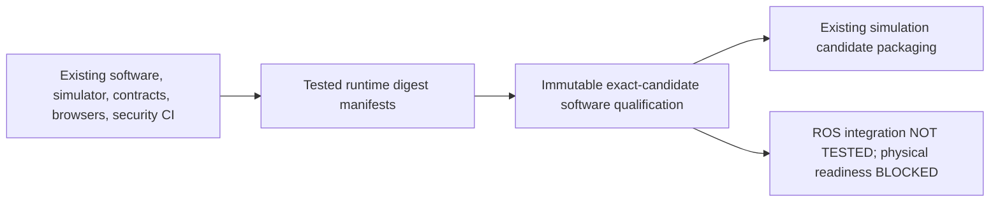

# Robot software and simulation qualification

`release-qualification.yml` automatically generates versioned `release-qualification`
Actions JSON evidence after current-main push CI/hygiene completion, or an owner manual
dispatch. It reads the latest exact-SHA push jobs from `scaffold.yml` and repository
hygiene; frontend/backend/container/runtime-security jobs must succeed. Backend pytest
covers independent safety bounds, cancellation, authorization, stale proposals, watchdog,
persistence and fault recovery. Frontend build/contracts/browser tests remain required.
Each successful security job uploads a sanitized tested-image digest manifest. Failure,
skip, cancellation, missing manifest or security evidence blocks software qualification.

`scripts/release/evidence.py` validates repository/workflow/event/commit/run identity
and immutable API artifact ZIP digests, parsing bounded JSON without extracting or
executing PR artifacts. Source hashing uses the portal/platform algorithm because robot
had no previous source-hash routine. No sibling repository imports or shared releases
are introduced. Evidence retains seven days and production-style approvals expire in
24 hours in the shared validator; no robot production approval workflow is installed.

The artifact always states `scope=software-and-simulation-only`,
`ROS2_VERIFIED=NOT TESTED`, `PHYSICAL_HARDWARE_READY=BLOCKED`. ROS 2 Jazzy interface
compilation/messaging has no implemented integration target; CI success never establishes
it. Staging, operations and content/legal gates remain blocked. Existing candidate
packaging remains separate and never deploys to hardware. Neither a physical actuation
adapter nor a hardware deployment workflow was introduced.

Changed `.github/workflows/scaffold.yml`; added
`.github/workflows/release-qualification.yml`, `scripts/release/evidence.py`,
`scripts/release/test_evidence.py` and this guide. Changelog/deployment guide updated.
Tests cover forged/stale/mismatched evidence, approvals/builds and CI failure paths,
and prove the generator cannot automatically issue human or hardware approval.
No robot release-review, provider deployment or hardware operation was performed.

Read-only GitHub inspection on 2026-10-11 observed public visibility, main protection
404, no rulesets, and Preview/Production environments without reviewers/branch policy.
No settings were changed. The user API exposed no subscription plan name. The selected
Free policy is documented locally. Public Free can support environment reviewers;
private Free cannot support this protected promotion architecture. Before any future
software promotion, activate/verify repository protection through the existing owner
process and supply real operator/legal/target evidence; do not infer physical safety.

Owner next steps: review the local branch, use the existing PR/check process, run
fresh remote CI and inspect the generated artifact. Configure and qualify a ROS
simulation adapter separately if needed. No secret is needed for software evidence;
provider credentials remain separate. Remote Actions dry-run is NOT RUN because these
changes were not pushed. Local tests are synthetic gate behavior, not hardware acceptance.

[GitHub environment limits](https://docs.github.com/en/actions/how-tos/deploy/configure-and-manage-deployments/manage-environments)
· [Artifact integrity API](https://docs.github.com/en/rest/actions/artifacts).

## Local verification report — 2026-10-11

Independent frontend build/type check and proxy regression passed; 18 backend simulator
tests passed. Contract regeneration matches; both Docker builds passed. Release tests
passed 12 applicable cases with nine nonapplicable application-promotion cases skipped.
Actionlint and publication hygiene passed. The ignored
`data/release-local/dry-run-summary.json` records synthetic local gate behavior, not
software publication or physical hardware acceptance. Remote AMD64/ROS/hardware
verification remains separate and no protection or provider setting was changed.
