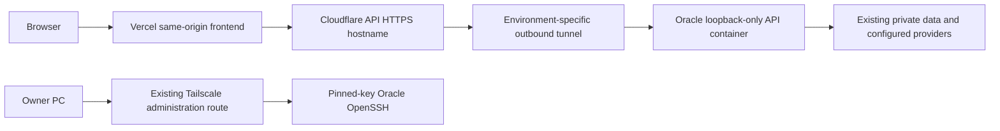

# Robot simulator deployment and recovery

## Primary release path

Start a normal release from the reviewed `dev → staging → main` candidate in the
existing owner-controlled Oracle/Vercel release procedure. Select the changed
component scope first; retain and independently verify unchanged backend images.
Do not begin with an old Render deployment command or repeat a successful build
without a source, artifact or environment change that invalidates its evidence.

1. Record the exact commit and component diff. Require its actual first-attempt
   GitHub CI/security results; skipped, missing, cancelled and local-only checks do
   not count as passing GitHub status checks.
2. Build immutable artifacts with isolated dependencies and no production credentials
   in PR jobs. Bind source, schema, image/artifact digests and retained components.
3. Qualify the candidate in the existing isolated staging environment, preserving
   data and using synthetic fixtures. Keep existing source-specific attempt limits.
4. Consume the existing source/evidence-bound owner authorization, then deploy only
   the qualified changed components through external owner credential custody.
   Actions `free-qualification.yml` / `free-authorization.yml` retain their supported
   provenance roles. External Oracle observations have run ID 0 and must never be
   relabelled as an Actions staging run or uploaded as a fabricated Actions PASS.
5. Read the provider's actual serving revisions and verify the canonical hosts,
   access boundaries and changed journeys. Only then record production acceptance.
   A deployment receipt without hosted acceptance is **deployed, not accepted**.

| State | Meaning |
| --- | --- |
| Skipped / blocked / failed | Required evidence is absent or unsuccessful; no promotion |
| Checks passed | The named checks passed for that exact source and environment |
| Qualified | Source-bound staging and required release evidence passed |
| Authorized | The owner decision binds the candidate and evidence; it is not a test result |
| Deployed | The provider accepted/serves the recorded artifact; acceptance is still separate |
| Accepted | Canonical-host verification passed for the actual serving components |

Alternate native-protection workflows are retained for their documented supported
targets; they are not a parallel automatic production authority. Render-specific
observers are for reconciling existing Render deployment IDs, not Oracle releases.
Recovery is exceptional and follows the existing pinned preservation/rollback plan;
normal release authorization never grants SQL repair, credential resets or old-source
Robot restarts. For the owner-managed future private transition, follow
[GitHub Free and hosted allowance](../development/FREE_GITHUB_PLAN.md). There is no
local-runner fallback, paid overage, unavailable reviewer requirement or missing-check
exception. G14 remains owner-deferred and unapproved.


## Current accepted recovery — 2026-10-17

Candidate `632746d` passed fresh exact-main verification `39037311691` and hygiene
`39037311612`. Its full Git tree equals qualified staging `295e80a`; all runtime
component bytes match actual staging backend `f591af4`. Production now runs that
reviewed ARM64 image, retaining the byte-identical frontend `f83b401`. Receipts
retain each actual source rather than relabel a component as the merge commit.

Fourteen API checks and 96 browser cases passed. The original post-run compound
accounting failure is preserved; its separately approved read-only continuation
verified all 917 prior staging records, 36 new owned terminal records and 77
production records. No browser rerun or additional full main context was needed.
The original assertion's failed subcondition remains unknown; the continuation
does not invent its cause or change the original result.

The single authorized new-source production replacement preserved all credentials,
configuration bytes and eight other service identities. Production operator login,
one approved software simulation, Stop, logout/revocation and six anonymous/spoofed
private-route denials passed. All 77 prior records are unchanged, one owned completed
record was added, and no pending task remains. Seven health/readiness samples over
180 seconds and runtime logs show healthy operation without journal latch, restart
or OOM. The owner-deferred development privacy scope is not legal certification.
Physical permission remains separate from unimplemented hardware; no actuation ran.

The existing restricted application-release evidence holds the source/CI/image,
container, preservation, acceptance and observation receipts under
`robot-postrelease-journal-incident/release/production/completion.json`.
Older release sections below remain historical. Continue the pinned new-source
recovery procedure on a future fault; this receipt grants no restart or SQL repair.

For the shared Oracle host, use the protected [VM architecture and troubleshooting](https://docs.engineering.onesa.eu/docs/engineering/ORACLE_VM_OPERATIONS).
It includes exact Robot health routes and journal-failure preservation; it grants no
old-source restart, lease repair or physical-operation authority.

## Oracle backend migration — owner authorized 2026-10-16

### Verified production hosting cutover — 2026-10-16

The existing Robot application now uses the Oracle API at `https://robot-api.onesa.eu`.
The Vercel frontend at https://robot.onesa.eu was republished from the identical accepted prebuilt
artifact, with only its server-side `ROBOT_API_URL` production binding changed. Frontend
source remains `595fd4f494e77de4fdecacbb9e64ac46c8c3597b`; backend source remains `595fd4f494e77de4fdecacbb9e64ac46c8c3597b`. This is a hosting
cutover, not qualification or publication of subsequent development features.
Existing owner/operator login, protected reads, logout and session revocation pass
through the canonical frontend proxy. Anonymous and spoofed-bot private requests
remain denied. A spoofed User-Agent is not evidence of genuine crawler traffic.

Both dedicated connectors use only the approved environment-specific API hosts,
with an observed unmatched-host `http_status:404` catch-all. Original application
credentials and external databases remain; no schema migration, worker/scanner
restart, billing change or physical actuation was requested. ARM64 image security
scans and matching-source staging access checks passed before production start.
New-target access checks reuse prior application qualification; they do not claim
a fresh full suite or new model-generation acceptance. Restricted operator receipts
hold the actual image, container, deployment, runtime-file and preservation identities.



The Render deployment/qualification scripts remain provider-specific and held;
do not dispatch them for this Oracle target or relabel Oracle checks as Render
qualification. Future application releases still need exact-source CI/security,
matching hosted staging, preservation and the owner-controlled release process.
Keep production credentials outside PR/Actions jobs. Separate staging bindings
and acceptance are recorded independently from the verified production cutover.

Rollback retains the preceding Vercel deployment and private origin value, plus
the pinned Oracle image and environment files. A Vercel rollback also restores
its earlier Render binding, which currently leads to a billing-suspended backend;
that is not an availability recovery. Rebind/redeploy a qualified retained artifact
to the healthy Oracle API instead. Stop promotion on uncertainty; do not restart
old Robot source, fence a lease, edit history or delete services to force recovery.


The owner now authorizes moving the existing staging and production APIs from Render
to the existing Oracle worker VM. This supersedes the backend-deployment pause for
this migration only. Keep qualification active; the Render billing hold itself remains.
Preserve the existing worker/scanner services, BaSyx, databases, credentials, accounts,
stored content, Robot history and physical-controller restrictions. Frontends stay on
Vercel; migrate only their server-side backend origin when the new target qualifies.

`compose.oracle-backend.yaml` defines independent staging/production API profiles.
Images must be ARM64, scanned, source-labelled and pinned by immutable image ID.
Each environment has separate networks, runtime files and (where used) storage volumes.
Ports bind only to loopback; no public API/container/database/SSH port is opened.
The existing PC-to-VM Tailscale SSH route remains an administrative connection.
Use an explicitly configured Cloudflare HTTPS tunnel for API ingress, retaining
application authentication/CSRF/ownership checks and existing Access/WAF protections.
No wildcard ingress or privileged crawler/session bypass is permitted.

Keep matching private runtime values in root-owned mode-600 files under
`/etc/onesa/backends/`; never copy them into Git or Actions. Preserve each environment's
original database, origin, key and inference/storage settings. Build from credential-free
Git archives off the VM and record exact backend tree, source commit, image ID,
archive digest and scan results in existing restricted evidence. The image map uses
`ORACLE_STAGING_IMAGE`, `ORACLE_PRODUCTION_IMAGE` and their corresponding `_COMMIT`
variables; both image values must be immutable `sha256:` IDs already loaded on the VM.

Run isolated config checks first, then deploy only the named staging service with
`docker compose --env-file <private-image-map> -f compose.oracle-backend.yaml
--profile staging up -d --no-build staging` (one command). Record healthy readiness,
private anonymous denial, authenticated workflows and measured host/container capacity.
An unavailable service or uncertain Robot journal lease stops activation; never repair
history through SQL or force an active lease. Reuse valid exact-source application
qualification and perform target-specific migration acceptance; local/config tests
alone are not hosted acceptance. Do not conceal a known application failure as PASS.

Only after the applicable staging/source/preservation gates pass, run the corresponding
explicit `--profile production ... production` command, then change the matching
frontend backend-origin binding and verify the deployed frontend revision and API.
Do not use `compose down`, restart workers, run migrations automatically, delete old
services, rotate credentials, provision paid capacity or change unrelated domains.
Keep the prior frontend/backend configuration and images for rollback. Render is
currently suspended: restoring its old URL is configuration rollback, not recovery of
service availability. On failure stop promotion and retain the actual partial state.

Staging has lower CPU shares/limits than production. Observe memory/OOM/error counters
and latency alongside the existing scanner and workers; a short idle sample does not
qualify peak load. Existing backups/monitoring remain active. Public documentation must
not publish the private runtime files, host inventory, source layouts or audit records.


## Render capacity hold — local maintenance, 2026-10-16

The owner confirms Render credits are exhausted and Render deployments remain paused.
Do not dispatch staging qualification that deploys to Render or request a Render recovery build,
resume a suspended service, change billing or provision paid capacity during this hold.
Continue non-deploying qualification and the authorized Oracle migration above. Preserve the
existing source-bound hosted results; they do not establish current API availability.
A restored Render budget is required before another Render build. Oracle migration
acceptance follows the source, staging, preservation and owner controls above.

The maintained deployment script now requires `suspended: not_suspended` and an
explicit empty `suspenders` list before creation and again when observing `live`.
Missing, malformed, contradictory or suspended service metadata blocks success;
a deployment's `live` status alone is insufficient. This check does not resume,
cancel or recreate a deployment. No availability failure is authentication evidence.
Offline regression: `python3 -m unittest discover -s scripts/release
-p test_deploy_render.py` (one command). Suspension during observation retains the
non-success receipt without falsely classifying a confirmed provider build failure.
These changes are prepared on development source; no new hosted release is claimed.
Rollback: revert only the reviewed maintenance commit, retaining existing receipts
and the owner-directed deployment pause.

Initial and failed simulator observations keep reset/propose/approve unavailable until
one complete status/history snapshot is confirmed. Stop, cancel and sign-out remain
independent. Unknown observations are labelled unavailable rather than left Loading.
Qualification waits for the reset acknowledgement before the unchanged Ready assertion;
this separates password-confirmed command latency from observation readiness. The local
held-observation fixture uses intercepted synthetic API responses and adds no journal rows.


Browser qualification waits for the server's approval acknowledgement before
starting its six-second completed-history assertion. Approval submission and durable
acknowledgement precede the simulation interval. A held-acknowledgement DOM fixture
covers this ordering without connecting to accounts, the journal or robot controls.
This test ordering does not change application timeouts, safety or release gates.

Audience/classification: authorized engineering / INTERNAL. Owner: Robot engineering.
Reviewed: 2026-10-14. Scope: software simulation only. Existing immutable deployment
receipts remain in the restricted release store; local changes are not hosted acceptance.

## Journal connection failures

The journal permits one HTTPX connection-establishment retry before a request is
sent. HTTP read inactivity and the outer operation deadline are both two seconds;
connect, write and pool deadlines remain one second.
The outer deadline bounds the whole statement, rather than allowing each phase
to add another two seconds. At most two connections may run concurrently; connections are not kept
for reuse between journal operations. A bounded 24-SELECT staging comparison observed
one read timeout in 12 pooled requests and none in 12 fresh-connection requests.
Fresh connections took longer in that sample; this is a conservative mitigation,
not proof of the historical failure's cause. Lease fencing, heartbeat and stop behavior
are unchanged.
Read/write/protocol failures never resend a statement. A lost acknowledgement still
requires one exact seven-field read under the same live lease; uncertainty fails closed.
Diagnostics now record only an allowlisted HTTP exception class and reconciliation
outcome alongside the existing fixed categories, never exception text or row contents.
The Oracle staging failure captured a one-second `ReadTimeout`. Twelve approved
read-only measurements from the same container succeeded, with end-to-end elapsed
times of 1.19–2.21 seconds including client construction. This supports removing
the earlier one-second phase cutoff within the unchanged two-second statement
budget; it does not establish the cause of network variability. Isolated real-HTTP
tests cover a delayed response within that budget and a response exceeding it,
including no statement replay. Hosted qualification is still required.
The earlier transport failure's exact subtype was not captured; do not retroactively
claim it was a connect error. See [HTTPX transport retry semantics](https://www.python-httpx.org/advanced/transports/).

A later staging preflight captured a `ReadTimeout` during lease renewal. An uncertain
renewal acknowledgement now permits one SELECT, within a four-second total
renewal/confirmation deadline, to confirm the same owner with at least 18 seconds remaining
on the database clock: the 15-second readiness window, at most two seconds of
response delay and a one-second clock-resolution margin. The previous 25-second
threshold incorrectly rejected a still-valid unrenewed lease after the normal
10-second renewal interval. Observation can confirm the existing expiry even when
the UPDATE did not commit; it never changes or assumes extension of that expiry. It never repeats the UPDATE, extends an
expired lease or accepts another owner. A missing, short-lived, malformed or
unavailable confirmation still stops the journal and revokes authority. Explicit
provider denials do not attempt reconciliation. Successful observation proves a
safely fresh lease; it does not establish why the original response was lost.

The per-statement deadline remains two seconds. Reserving a further two seconds
for this single read prevents an uncertain write from consuming the whole
confirmation budget. The ten-second renewal interval plus four-second total is
still inside the fifteen-second readiness window. Reconciliation never retries
the UPDATE or extends the observed lease; unavailable confirmation fails closed.
This correction is prepared source, pending exact-source CI, the owner's bounded
Oracle staging qualification and preservation-checked new-source recovery.

## Restricted development release and owner deferral

Robot is under development. Its protected operator interface supports authorized
software development/testing, with essential authentication sessions, operator-linked
synthetic history and necessary security diagnostics. It is not a customer launch or
an integrated physical controller. The owner explicitly deferred the legal-basis,
history/backup/provider-log retention and existing-provider processing/transfer records
until launch on 2026-10-15. Those records remain unapproved; no legal compliance,
executed provider agreement or external lawyer certification is inferred.

Use the existing credential-free manual `free-authorization.yml` decision, selecting
`defer_development_privacy=true` only for that reviewed restricted development scope.
The immutable owner artifact records `DEFERRED_BY_OWNER_UNTIL_LAUNCH`, separately from
the untouched qualification's blocked legal/operations fields. The source must state
`Under development` and protected development/testing access. An external production
preflight may carry that exact deferral only after `free_gate` revalidates the latest
owner artifact, exact main, fresh CI/staging, source digest and current authorization.
GitHub Actions cannot use this exception to deploy. It grants no operations PASS:
current preservation, backup/recovery, operating limits and scoped operations review
are still required. Authentication, CSRF, private telemetry, credentials, history and
physical-controller safety requirements are unchanged.

Keep the deferred records in the existing restricted review and master evidence
register as launch blockers. A change to customer access, processing purpose,
providers or physical operation needs its own review; this decision cannot grant it.
Revoking/superseding the owner authorization or changing the exact candidate invalidates
the handoff. The default authorization path and all other production gates remain.

## Current deployed baseline and storage

The current October 15 production frontend and backend both serve
`595fd4f494e77de4fdecacbb9e64ac46c8c3597b`. Vercel is
`dpl_FX54UPw53gMQ1TL7sY2kMH71YfKW`; Render is `dep-db8g94o473hc73ert5h0`.
Exact-main CI `38768560790`, hosted staging `38769589380` (16 API/safety checks,
96 browser cases), qualification `38771745184` and authorization `38771808387` passed.
Production acceptance passed 14 API/safety/admin checks, two public layouts, anonymous
console isolation and six private-data denials. All 73 previous records and credentials
were preserved; three owned synthetic terminal records bring the journal to 76.
Final state is stopped/idle, physical permission blocked and controller not connected.
The restricted `closure-robot-main595-production-acceptance.json` records source,
deployments, preservation, bounded runtime observations and monitor-only continuations.
Scheduled backups and a hosted Turso restore remain unverified; the pre-deployment
encrypted off-host snapshot and isolated application restore do not establish them.

### Prior October 14 baseline

The prior October 14 production frontend was
`56ce52f20ddf7a491de0b33a3805d0c02cc0d345`, Vercel
`dpl_ENwtg1yhAww2dZURnrabR4b5NraD`, at `https://robot.onesa.eu`.
It retains backend `16381086192dc34c8ad7ea40c43ef6d178b00904`, Render
`dep-db7f3oe7bikc73aldipg`. The source-bound qualification and owner authorization
preceded this frontend-only delivery; actual API acceptance passed 13/13, while
mandatory browser acceptance **failed at 80/81**. Preserve the failed WebKit
sign-out observation; the precise original focus state was not captured. The later
explicit originating-form correction has passed source/local and earlier hosted
staging checks but has not been deployed to production. Journal recovery-required
503s were observed separately at 09:09 and 09:32 UTC; a bounded read-only readiness
observation passed at 09:59, followed by stable complete-history/idle checks at
10:05. These observations neither explain the latch nor qualify a new release.
No production restart was performed. Restricted records are in
`docs/internal/release-audit/evidence/system-design-v2-main-56ce52f/`.

The earlier October 14 production source was
`16381086192dc34c8ad7ea40c43ef6d178b00904`: the same Render deployment and Vercel
`dpl_J13jsKeKNGCMqMWbdUV9i45JUcGm`. Exact main CI, fresh hosted staging,
qualification `38501657824` and owner authorization `38501859388` passed before
deployment. Actual production API/safety/edge checks are 13/13 PASS. Initial hosted
browser acceptance is **FAIL: 67/69 passed**, with two Chromium sign-ins returning
503 Gateway unavailable; Firefox and WebKit each passed all 23. The provider receipt
remains BLOCKED at the mandatory browser gate. Subsequent bounded readiness samples
passed, but Render cold wake as the specific cause is not verified. Existing credentials
and all three earlier history records were retained; the confirmed idle stop latch
was restored and physical actuation remains disabled. Restricted evidence is in
`docs/internal/release-audit/evidence/system-design-v2-main-1638108/`; the failed suite
is retained and a qualified frontend recovery release must pass actual acceptance.

The earlier October 13 recovery baseline is source
`b0d40c6d2ccab2b1663166ebf311b4a9755ad045` at `https://robot.onesa.eu`. Restricted
`data/runtime/production-release/hosted-acceptance.json` records all 13 hosted checks
PASS at 20:03:33 UTC. Render deployment `dep-db78k3a5b2lc73euuvl0`, Vercel deployment
`dpl_2xe3R4Nphug6xBZ317onVEiPwJP7`; owner authorization run `38410878463` binds the
qualification run `38410516546`. These receipts attest that baseline, not a later diff.
Physical actuation is disabled. Scheduled journal recovery, alerts and physical safety
remain separate gates; the baseline does not manufacture their approval.

The owner-selected production service `srv-db5k88flk1mc73aa9110` uses the existing
`libsql://onesa-ai-robot-backend-druhustle.aws-eu-west-1.turso.io` task journal on Free
Frankfurt native Render. `ROBOT_STORAGE_MODE=turso` and
`ROBOT_DEPLOYMENT_ENVIRONMENT=production` permit only that production database.
Staging uses its separate verified hyphenated `onesa-ai-robot-backend-staging`
database. Production and staging database-scoped tokens and operator-password hashes
must remain distinct. Never reset operator credentials to make a test pass.

Ephemeral SQLite remains blocked for production. Turso uses an in-memory SQLite
working store and exclusive remote journal, with process-local revoked-on-restart
sessions. Do not set an unused cloud filesystem database path, attach either sibling's
database, claim a paid disk or silently fall back to ephemeral history.

## Configuration and authority

The owner-requested administration software is a new candidate, not part of the
previous 83f7579 qualification. After its own exact-source CI and staging checks,
bind `ROBOT_ADMINISTRATOR_NAME` only to the existing approved operator name in
each intended environment. Preserve the operator/password/device credentials,
journal and other configuration. Do not enable a different account or infer an
administrator role from browser markup or a request body. The protected console
then offers session-bound allow/block permission, with separate hardware state.
Hardware is still in development; no real controller or physical actuation is
claimed. A missing administrator designation fails the newly mandatory hosted
`administrator_operation_permission` check, rather than silently skipping it.
The 83f7579 15-check/84-view result remains valid only for its older source;
fresh qualification is required for the new control/authentication surface.

Inspect current providers and private bindings before a write. Native builds use
`python -m pip install --require-hashes -r requirements.lock` and single-process
`sh start.sh` with the repository Python version. Render automatic deployment remains
off. Use `/api/v1/health` for rollout liveness and `/api/v1/ready` for acceptance.
Preserve the actual existing operator, session/heartbeat limits, independent synthetic
edge identity and `ROBOT_ACTUATION_ENABLED=false`. Set the exact browser origin; server-only
Vercel `ROBOT_API_URL` targets the corresponding Render origin.

Credentials stay in the approved private provider configuration and external release
custody. Inspect only presence/scope and boolean usability; do not print environment
values, hashes, tokens or provider bodies. Rotate an expiring database token through
the approved secure process without disturbing operator passwords or journal data.

Keep only **dev**, **staging** and **main** permanently. Normal integration is
**dev → staging → main**; temporary security PR/candidate exceptions follow
[the scoped security procedure](CI_CD.md#security-pr-integration-and-urgent-candidates).
Exact-source CI, hosted staging, artifact/qualification,
applicable operations/content scope and actual current owner authority precede release.
Do not claim private GitHub Free supports native protection without real readback.
Provider Git staging previews are the staging frontend authority; production Vercel
and Render use the established controlled external handoff. See
[AUTOMATED_QUALIFICATION.md](AUTOMATED_QUALIFICATION.md) and current restricted receipts.

## Gateway and product routes

The public `/` product page has no private API scripts. `/console` serves the operator
sign-in shell; its JavaScript contains no private state or credentials, and all
telemetry/history/control reads require a valid backend operator session. Static shell
availability does not grant access. Appearance follows OS preference independently.
Protected status responses supply observation time and trusted deployment environment.

Console sign-in checks credential-free readiness with a 20-second upper bound before
submitting credentials once. Temporary unavailability retains masked input for an
explicit retry; successful or rejected authentication clears passwords. These checks
exist only in the operator shell. Readiness cannot grant authority, and approvals,
reset, task creation or control commands are never automatically replayed.

## Independent frontend delivery

Full releases remain the default. An owner may explicitly select `release_mode:
frontend-only` in the existing staging workflow or candidate bridge, with the prior
`baseline_authorization_run`. The current baseline is owner authorization `38501859388`
for backend source 1638108. The application packaging choice alone does not enable reuse.

The verifier reads immutable GitHub authorization, qualification, CI/build and staging
artifacts directly. It rejects stale/superseded/revoked/foreign proofs, incorrect owner
or branch/event, altered artifacts and chains of retained-component proofs. It derives
backend tree, Render reference/runtime context, root configuration, generated API/schema,
hand-owned client contract, ROS and edge identities from exact GitHub commit objects.
All must be byte-identical and the baseline must be an ancestor. Every new candidate
still requires exact main CI, fresh hosted staging, new qualification and a new owner
authorization. No caller-supplied PASS record or substituted repository SHA is accepted.

Staging verifies existing baseline source/readiness before journal handoff, binds only
the verified new protected Preview origin and purposefully restarts the unchanged
baseline backend source. Its receipt records the actual baseline backend commit and
new candidate frontend commit. Production's canonical origin stays fixed: after a
fresh external gate, set `ROBOT_AUTHORIZATION_RUN` to the new authorization and run
`cloud.py retain-backend Production --directory <private-release-directory>` from the
clean reviewed main checkout before the Vercel operation. This command performs no
provider write; it rederives authorization, verifies actual latest live backend source,
runtime bindings and readiness, and saves the retained deployment identity.

Preserve the private preflight record from the new trusted qualification. Final receipts
independently refresh component provenance and actual provider source/readiness, compare
the release's complete runtime configuration privately, and record both actual component
versions and prior backend build/authorization provenance. Credential digests remain in
ephemeral private files, never in Git, printed logs or uploaded receipt artifacts. The
retained backend must not be redeployed for icons/CSS. Missing/expired baseline proof or
backend/contract drift blocks this mode; never pass a false SHA to smoke or receipt checks.

The gateway permits an eight-second upstream acknowledgement, below the generated
client's ten-second cancellation deadline. The journal can consume two seconds for
a statement and up to four seconds for bounded confirmation; ingress needs its own
margin. The incoming-body limit, watchdog, lease freshness and task-completion
limits are independent and unchanged. A timeout never authorizes a repeated POST.
Buffer the complete upstream body before forwarding its status or session cookie;
a body timeout must not become HTTP200 with an error appended. Failure responses
and provider logs use fixed `X-Onesa-Gateway-Error` categories only, without URLs,
operator identifiers, cookies, passwords or exception messages. Check current state
before manually reconsidering an uncertain operation.

Failed browser evidence includes only allowlisted page/static-asset and redacted
API timing. An initial navigation timeout is not evidence of a backend journal
failure. Keep the normal navigation deadline and zero automatic test retries;
investigate the captured layer before requesting another qualification context.

Route `/api/v1/:__onesa_route*` to `api/gateway.mjs`. The adapter removes only one
metadata value matching the original nested API path; reject extra, duplicate or
mismatched values, arbitrary upstreams and direct gateway/private paths. Preserve
session-cookie filtering, exact Origin/CSRF, TLS and no-store. Provider bypass secrets
must never be forwarded to Render. Check real Vercel nested artifacts and hosted routes.

## Safe staging origin handoff and rolling journal ownership

1. Resolve the exact-source protected Preview and inspect the existing running origin.
2. Authenticate the existing synthetic test operator using its approved private test
   credential. Before stopping, verify simulation mode, disabled physical actuation,
   an already latched stop, no active task, no running/proposed recent history and zero
   pending rows across the complete existing staging journal. The handoff sends no
   stop or cancellation request. Preserve unknown work and coordinate its owner if
   any check fails. Recheck the latched idle runtime and unchanged history, then fence
   only the observed lease using an atomic owner and no-pending-work predicate. Verify
   that same owner, expired lease and idle journal together. A newly acknowledged
   pending task prevents fencing; existing backend writes require the live lease.
   The qualification fixture is owner-coordinated and synthetic; snapshots do not
   certify arbitrary concurrent operator activity. Only the run-owned acceptance
   scenario may restore its stop latch after its own completed task and idle readback.
   Preserve credentials and production; never cancel preexisting work to pass a release.
3. Save the new verified Preview origin, then deploy the exact qualified source. Saved
   Render environment changes do not attest the running configuration. If an earlier
   attempt changed saved origin prematurely, reconcile only staging to a verified
   origin accepted by the live runtime; never weaken the origin check.
4. The replacement may report liveness while waiting up to 90 seconds for the old
   instance to release its lease. Login/readiness/all application routes return 503
   until exclusive ownership and history are restored. It never steals an active lease.
5. Verify actual readiness, preserved history, operator authentication and complete
   simulation/edge/browser acceptance. A login PASS cannot qualify independent device
   telemetry. Failing startup stays unavailable; no automatic resume occurs.

Render Free wake-up can produce a bounded initial 503 through the gateway. Record cold
and warm observations separately; do not hide an unresolved persistent outage behind
retry or keep a free instance artificially awake.

## Journal availability diagnosis and prepared full release

The exact-main staging run `38555383546` for
`53803249d27de78af4ed971dac10feb139370266` failed its mandatory hosted suite at
**59/84** (Chromium 28/28, Firefox 18/28, WebKit 13/28). Its source tree matches
the earlier `826e65e` staging run that passed 15 API/safety checks and all 84 browser
cases. That earlier PASS does not qualify this failed run. No trusted staging
receipt artifact was generated. Preserve the complete failed log and sanitized
diagnosis in the existing restricted `system-design-v2-form-origin-ca75187` audit.

At 11:43 UTC a bounded read-only direct staging check returned the fixed
recovery-required 503. Two complete SELECT-only snapshots of the current journal
matched: 348 rows, zero pending tasks and one expired lease. These compare only
that observed window; no complete before-suite comparator survived the failed run.
The sampled provider logs contained no exception type or operation phase. The
underlying trigger remains unproven. Source inspection disproved the hypothesis
that reset marks all historical tasks dirty: reset changes the safety flag, and
cancellation marks only running/proposed tasks. Flush-before-renewal is a source
timing observation, not evidence of this incident's cause.

The prepared diagnostic change emits one warning in the existing protected backend
log when journal failure first latches. It records only an allowlisted category,
an explicit operation phase, clamped integer monotonic elapsed milliseconds and an
optional numeric HTTP status. It excludes exception text, SQL, URLs, tokens, task
identifiers, row contents, raw responses and tracebacks. Anonymous 503 responses
remain unchanged. A timeout category identifies a timed-out boundary; ownership
means a guarded statement did not return the expected owner. Neither proves a
provider outage or permits automatic recovery. A stale-lease warning identifies
the existing readiness freshness check, not the cause of missed renewal.

The patch preserves the one-second HTTP budget, two-second overall RPC budget,
10-second renewal, 15-second readiness freshness and 30-second lease, together
with existing flush order, fencing, cancellation, watchdog and no-retry behavior.
Lifecycle cancellation propagates; an ambiguous write is never replayed. This
backend change requires a **full** release with new exact-source CI, fresh hosted
staging, immutable artifacts, qualification and owner authorization. Earlier
frontend-only retained-backend proofs and prepared builds do not attest it.

Before any provider operation, present the reviewed source, isolated negative
tests, actual failed-run evidence and narrowly scoped plan to the release owner.
Confirm the exact existing staging service, source/configuration, complete history,
already-stopped idle state, zero pending work and current lease/deployment/Actions
state. Preserve unknown work and hold if any check is inconclusive. A failed journal
does not authorize a stop, lease edit, token rotation, history deletion or production
restart. No recovery or additional hosted attempt is automatic. Record attempts
for the same unresolved episode and stop by the master limit of three; the failed
exact-main suite above is attempt one, with zero recovery restarts or retries.
After any separately authorized staging cutover, require actual history/readiness
and the complete 15/84 hosted gates before normal main qualification. Production
provider writes require a new concrete owner-reviewed plan and fresh external gate.

## Render deployment receipts and bounded observation

`scripts/deploy_render.py` separates a single create request from observation of
the accepted deployment. It saves an owner-only sanitized receipt before the
request, immediately after acceptance, on status transitions and on observation
failure. The adjacent `render-preflight.json` contains only the source/run binding;
it grants no deployment or acceptance authority. Both existing cloud workflows
upload these two exact files as `render-deployment-observation` immediately after
the backend step, including on failure, before application acceptance. They never
upload a directory containing credentials, runtime configuration or task data.

The initial observation window remains 1,800 seconds, including provider preflight
and submission. Each complete HTTP operation, including its response body, has a
20-second deadline. GET rate-limit recovery permits at most three requests with a
bounded delay; POST is never retried. Polling backs off from five to thirty seconds
and reports transitions or a summary every ninety seconds. The backend step has
a 32-minute limit and the immediate artifact step two minutes; the existing outer
job stays at sixty minutes. No provider build limit was increased: Render documents
up to 120 minutes for a build command. Longer work needs a controlled observation
continuation, not a runner waiting indefinitely or another build request.

An observation timeout exits nonzero, blocks subsequent deployment/acceptance and
records that Render may continue independently. `build_failed`, `update_failed`
and `pre_deploy_failed` are confirmed provider failures; `canceled` and
`deactivated` are distinct non-success outcomes. `live` succeeds only when the
exact source is still the latest live deployment. It still records application
acceptance as NOT TESTED and grants no promotion authority. Unknown states,
wrong sources, changed targets and malformed responses fail closed.

To observe an existing version-2 receipt, first retrieve the exact original
`render-deployment-observation` artifact from the independently verified owner run.
Keep the downloaded original and artifact digest in the restricted evidence store.
Copy its two files into a new owner-only continuation directory, set the receipt
to mode 0600, and independently pin the copied receipt's SHA256. Using the existing
authorized Render credential in private operator custody, run:

```sh
python3 scripts/deploy_render.py --environment Staging \
  --observe-id dep-EXACT_DEPLOYMENT_ID --candidate EXACT_REQUESTED_CANDIDATE_SHA \
  --preflight /private/continuation/render-preflight.json \
  --receipt /private/continuation/render.json --receipt-sha256 EXACT_RECEIPT_SHA256 \
  --wait-seconds 1800 --request-timeout 20
```

The existing `RENDER_SERVICE_ID` and `GITHUB_REF` must match that environment's
fixed service and permanent branch. The observer validates the receipt hash,
original source/run binding, service configuration and actual deployment commit;
its transport rejects every POST. It makes no application, operator, SQL,
cancellation, restart or cache-clear request. Resuming observation consumes no
full hosted qualification attempt and cannot resume skipped acceptance jobs.
After any actual live result, follow the existing source-bound staging, approval
and hosted acceptance process within its separately authorized attempt budget.

For an ambiguous create response, preserve the request intent and reconcile the
provider's exact recent deployments before any further submission. An existing
active deployment or matching source blocks a duplicate full create. Do not erase
the receipt to evade that guard. The older script saved a receipt only on success;
a failed legacy run may have no receipt. Never fabricate its original preflight
or claim it can be resumed through the version-2 path. Reconcile its immutable
workflow log and exact provider record separately in the existing restricted audit.

The October 14 run `38628644160` targeted the fixed **staging** service and commit
`0299570`, not production. Its local 1,800-second timeout did not cancel Render.
The subsequent operator-owned cancellation was separately verified; no hosted
API/browser acceptance started. Current restricted evidence preserves provider
times, serving source, the zero-entry build-log readback and Render's reported
regional build incident. No dependency, model, hardware package, memory, cache or
quota cause is inferred without actual build evidence. No build file or hosting
plan change is justified by that empty log result.

Sources: [Render deploy states](https://api-docs.render.com/reference/retrieve-deploy),
[rate limits](https://api-docs.render.com/reference/rate-limiting),
[build pipeline limits](https://render.com/docs/build-pipeline).

## Recovery, rollback and administrative tunnel

For a task-save timeout or transport loss, the journal may have committed before
the acknowledgement arrived. The client performs one bounded read of all seven
persisted fields, requiring its unchanged, unexpired writer lease. An exact match
acknowledges that save without another write. A missing/different row, lost lease,
failed observation, explicit provider denial or invalid response still fails closed.
The HTTP and per-operation deadlines remain unchanged; at most one extra read is
allowed, with no command replay, automatic process restart or permission restoration.
This does not recover a journal that has already latched unavailable: stop promotion
and preserve its history, lease and pending-work evidence under the existing recovery
controls before any separately reviewed recovery deployment.

Require an already-stopped, confirmed idle runtime before rollback; preserve unknown
active or proposed work and coordinate its owner rather than cancelling it to release.
Preserve the private journal and retain the stop latch.
Sessions revoke and unfinished tasks cancel on restart. Recheck origin/API/schema/
artifact compatibility. Do not restore active sessions or automatically replay commands.
Test backup/restoration only in an isolated authorized destination; prove retained
history, fenced single-writer ownership, revoked authority and no resumed task. Scheduled
backup execution, key recovery, retention and alert delivery need their own actual evidence.

The owner reports a **Tailscale tunnel between the PC and VM** for private administration.
Its console is `https://console.tailscale.com/`. Treat it as a distinct encrypted
administrative boundary, with existing identity/device approval and scoped tailnet
policy; verify actual node identity, ACL/grants, expiry and active transport through
read-only inspection before claiming runtime PASS. Do not disclose node keys or enlarge
SSH/firewall access. The tunnel is not cloud-to-edge Robot motion transport, does not
replace operator/device authorization and must not expose DDS, actuators or model listeners.

No physical driver, camera/STT/VLM/TTS/VLA integration or installed edge-control update
is authorized by a software release. Keep separate software, ROS compatibility, edge
installation, real-model and physical-hardware verdicts.


The public landing, operator and development-privacy footers route general contact to
the Company Contact enquiry form. Approved controller/privacy contact particulars remain
in the privacy notice body; the footer does not duplicate email or telephone links.

## Early lease-renewal candidate (not deployed)

The prepared backend renews every five seconds instead of ten. The previous
successful response may already have consumed part of the database's 30-second
lease. Waiting ten more seconds and then using the existing four-second uncertain-
acknowledgement/confirmation budget can leave less than the required 18 seconds
at the read, even though the lease has not expired. A late commit can subsequently
appear after the process has already latched. The actual network/provider cause
of a timeout must be distinguished from this reproducible timing sensitivity.

The candidate keeps the existing lease TTL, same-owner/unexpired fencing, strict
freshness check, statement/confirmation deadlines and 15-second readiness window.
It neither retries a statement nor reacquires an expired/foreign lease. Missing
proof still stops simulation, revokes permission and fails readiness. No task or
physical operation resumes automatically. An unavailable provider is not a
passing qualification, and a new timing test is not hosted recovery evidence.

At idle, two continuously running environments would issue approximately
1,071,360 renewal statements in 31 days before other workloads. Verify the actual
account's plan, metering and remaining capacity; never enable paid overages or
increase quotas as part of recovery. Preserve the accepted frontend when its tree
is identical, and record its real source separately from the backend candidate.
Use the existing exact-source pipeline and scoped failed-container preservation
exception before any replacement. Do not restart the old failed source, edit SQL
history or weaken readiness just to obtain a green status.
