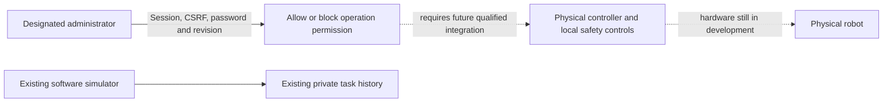
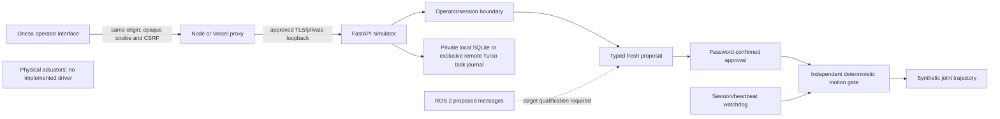
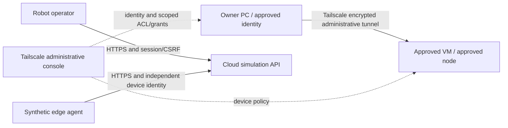

# Software simulation architecture

## Administrator permission and future physical controllers

The owner identifies the product as pre-launch and under development; hardware
has not yet been developed. The new administration software separates
**permission**, **controller connection/readiness**, and **actual operation**.
An explicit `ROBOT_ADMINISTRATOR_NAME` may identify only the existing configured
operator. Other operator sessions receive 403 from all administration endpoints.
`/api/v1/admin/physical-operation` is authenticated, non-cacheable state; its
`allow` operation requires the administrator password, current revision and an
already-stopped idle simulator. `block` needs the administrator session and CSRF
but no extra password, and invalidates any in-flight allow confirmation.

Permission is bound to the issuing session, expires with it, and is revoked on
logout, process restart, Stop, storage failure or watchdog failure. It is held
in process memory, with no new remote table, migration, operator account or
credential. It cannot approve/replay simulator tasks or send hardware commands.
The software truthfully reports `not_connected`, `not_ready` and `inactive`
until a real controller is integrated; an administrative allow is never reported
as physical actuation. Future hardware adapters must enforce device identity,
fresh bounded control authority, local interlocks, emergency stop and watchdog
independently. The existing telemetry-only edge bearer grants none of that authority.

No model output or ROS message grants authority. Quintic smooth-step trajectories
are checked against synthetic SI-unit position/velocity/acceleration limits.
Proposals expire after 15 seconds; UUID reuse is rejected. Only one task runs, owned
by its approving session. Heartbeat loss, expiry, logout, cancel/stop, watchdog failure
or restart removes in-memory execution authority. Operator reset never resumes work.

Storage tables: sessions (hashed opaque token, CSRF, expiry, operator), tasks (ID,
operator, validated proposal, state/reason, timestamps and synthetic position), safety
(single durable stop latch). Sessions are revoked on process startup. No product
customer data or sibling database is used. Query results and UI text are bounded.

Auth/CSRF/ownership, limits, stale/future messages, completion, replay, connection
loss, cancellation, session expiry/revocation and restart are software tests. There
is no actual perception/model-policy path, connected ROS runtime or hardware safety
certification. Those dependencies must remain explicit, never silently simulated
inside a response labelled as a real robot or real model.

## Optional simulated edge telemetry

The separate `edge/simulation-agent.py` sends version-1 HTTPS telemetry outbound to
Render. It uses an independent per-device bearer token; the API stores only SHA256
of that token. Boot challenge, monotonic sequence, three-second freshness and ten
requests/second are enforced. Telemetry is explicitly synthetic and stopped, and
cannot create/approve/reset tasks or change the safety gate. Stale/disconnected
telemetry becomes `not_connected`. Bounded telemetry audit is in process memory;
it is not durable compliance logging. Task history remains in private SQLite.

No inbound edge listener, DDS exposure, Robot control tunnel, router change or automatic retry
is introduced. A failed agent stops and requires operator restart. There is no
cloud-to-edge motion/action transport: the cloud simulator retains its existing
independent motion gate, while a future real edge adapter must enforce its own
hardware-specific safety rules regardless of cloud state. Follow the separate
[release process](AUTOMATED_QUALIFICATION.md) before packaging/installing any adapter.

## Public product, operator context and system appearance

The public product root renders a static concept image without JavaScript or
private API subscriptions. `/console` has a task-oriented operator shell; backend
session/CSRF and ownership decide access. Status observation times and deployment
labels come from protected runtime responses, independently of simulation mode.
Both shells consume the exact shared foundation recorded in
`design-system.consumer.json`. CSS follows browser/OS preference without a clock,
selector or stored theme. A preference transition cannot reconnect telemetry, submit
commands, clear a draft, change focus or revoke a session.

## Separate PC–VM administrative tunnel

The owner-reported PC–VM tunnel is included as an administrative dependency; active
node/ACL/transport state still requires actual read-only account/host evidence. Robot
simulation and its edge telemetry retain their separate authorization and transport.
A tailnet connection grants no operator role or physical readiness. Do not expose
public controller/DDS/model ports, alter unrelated access or put Tailscale node keys
in docs. Current policy decisions remain in the Portal governance database rather
than a competing mutable Markdown policy store.
