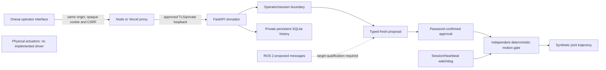

# Software simulation architecture

No model output or ROS message grants authority. Quintic smooth-step trajectories
are checked against synthetic SI-unit position/velocity/acceleration limits.
Proposals expire after 15 seconds; UUID reuse is rejected. Only one task runs, owned
by its approving session. Heartbeat loss, expiry, logout, cancel/stop, watchdog failure
or restart removes in-memory execution authority. Operator reset never resumes work.

Storage tables: sessions (hashed opaque token, CSRF, expiry, operator), tasks (ID,
operator, validated proposal, state/reason, timestamps and synthetic position), safety
(single durable stop latch). Sessions are revoked on process startup. No product
customer data or sibling database is used. Query results and UI text are bounded.

Auth/CSRF/ownership, limits, stale/future messages, completion, replay, connection
loss, cancellation, session expiry/revocation and restart are software tests. There
is no actual perception/model-policy path, connected ROS runtime or hardware safety
certification. Those dependencies must remain explicit, never silently simulated
inside a response labelled as a real robot or real model.
