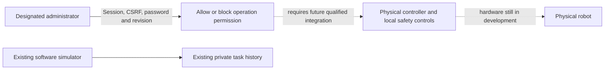
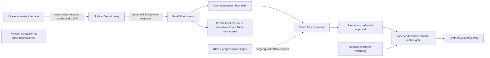
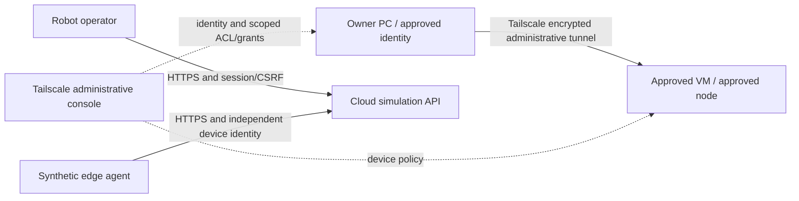

# Software simulation architecture

## Administrator permission and future physical controllers

The owner identifies the product as pre-launch and under development; hardware
has not yet been developed. The new administration software separates
**permission**, **controller connection/readiness**, and **actual operation**.
An explicit `ROBOT_ADMINISTRATOR_NAME` may identify only the existing configured
operator. Other operator sessions receive 403 from all administration endpoints.
`/api/v1/admin/physical-operation` is authenticated, non-cacheable state; its
`allow` operation requires the administrator password, current revision and an
already-stopped idle simulator. `block` needs the administrator session and CSRF
but no extra password, and invalidates any in-flight allow confirmation.

Permission is bound to the issuing session, expires with it, and is revoked on
logout, process restart, Stop, storage failure or watchdog failure. It is held
in process memory, with no new remote table, migration, operator account or
credential. It cannot approve/replay simulator tasks or send hardware commands.
The software truthfully reports `not_connected`, `not_ready` and `inactive`
until a real controller is integrated; an administrative allow is never reported
as physical actuation. Future hardware adapters must enforce device identity,
fresh bounded control authority, local interlocks, emergency stop and watchdog
independently. The existing telemetry-only edge bearer grants none of that authority.

No model output or ROS message grants authority. Quintic smooth-step trajectories
are checked against synthetic SI-unit position/velocity/acceleration limits.
Proposals expire after 15 seconds; UUID reuse is rejected. Only one task runs, owned
by its approving session. Heartbeat loss, expiry, logout, cancel/stop, watchdog failure
or restart removes in-memory execution authority. Operator reset never resumes work.

Storage tables: sessions (hashed opaque token, CSRF, expiry, operator), tasks (ID,
operator, validated proposal, state/reason, timestamps and synthetic position), safety
(single durable stop latch). Sessions are revoked on process startup. No product
customer data or sibling database is used. Query results and UI text are bounded.

Auth/CSRF/ownership, limits, stale/future messages, completion, replay, connection
loss, cancellation, session expiry/revocation and restart are software tests. There
is no actual perception/model-policy path, connected ROS runtime or hardware safety
certification. Those dependencies must remain explicit, never silently simulated
inside a response labelled as a real robot or real model.

## Remote-journal lease confirmation

The cloud journal has one database-fenced writer. Ordinary statements remain
bounded to two seconds. The prepared read-only renewal confirmation has a
five-second bound and a seven-second complete renewal bound, below the existing
fifteen-second readiness window after the five-second renewal interval. Only the
exact same-owner lease SELECT receives this longer bound. Its database lifetime
must retain the existing eighteen-second minimum and cover measured response
age, fifteen-second readiness and a one-second resolution margin. An uncertain
write is never replayed. Failure still stops and requires controlled recovery;
this preparation is not evidence that it is deployed or that hardware is ready.

## Prepared idle-only transport recovery

This correction is source-tested and remains unreleased until the normal exact-source
CI, staging and production acceptance gates pass. It does not establish high
availability or identify the original provider/network timeout cause.

A transient renewal timeout/transport error may enter bounded recovery only when
this instance had already initialized, was stopped and idle, had no pending tasks
or dirty writes, and had no physical actuation enabled. Other failure categories,
active/armed/uncertain work, schema/history changes and exhausted attempts remain
latched for controlled operator recovery.

After delays of 30, 60 and 120 seconds, at most three attempts may acquire a fresh
random lease identity through the existing atomic expired-owner condition. A live
other owner is never displaced. Remote terminal history must exactly match the
last acknowledged history and local cache; no task record is repaired, replayed,
removed or resumed. A new successful renewal must precede readiness. Ordinary
statement, confirmation and readiness bounds remain unchanged.

Recovery revokes previous sessions and administrative motion permission, preserves
the stopped state and requires fresh operator sign-in/reset. The simulator resumes
no task. Each recovery attempt is bounded to 20 seconds; independent Stop/heartbeat/
logout handling and the safety watchdog stay available. There is no process restart,
new account, credential change, migration or hardware activation.

## Optional simulated edge telemetry

The separate `edge/simulation-agent.py` sends version-1 HTTPS telemetry outbound to
the current Oracle-hosted API through its existing HTTPS ingress. It uses an independent per-device bearer token; the API stores only SHA256
of that token. Boot challenge, monotonic sequence, three-second freshness and ten
requests/second are enforced. Telemetry is explicitly synthetic and stopped, and
cannot create/approve/reset tasks or change the safety gate. Stale/disconnected
telemetry becomes `not_connected`. Bounded telemetry audit is in process memory;
it is not durable compliance logging. Task history remains in private SQLite.

No inbound edge listener, DDS exposure, Robot control tunnel, router change or automatic retry
is introduced. A failed agent stops and requires operator restart. There is no
cloud-to-edge motion/action transport: the cloud simulator retains its existing
independent motion gate, while a future real edge adapter must enforce its own
hardware-specific safety rules regardless of cloud state. Follow the separate
[release process](AUTOMATED_QUALIFICATION.md) before packaging/installing any adapter.

## Public product, operator context and system appearance

The public product root renders a static concept image without JavaScript or
private API subscriptions. `/console` has a task-oriented operator shell; backend
session/CSRF and ownership decide access. Status observation times and deployment
labels come from protected runtime responses, independently of simulation mode.
Both shells consume the exact shared foundation recorded in
`design-system.consumer.json`. CSS follows browser/OS preference without a clock,
selector or stored theme. A preference transition cannot reconnect telemetry, submit
commands, clear a draft, change focus or revoke a session.

## Separate PC–VM administrative tunnel

The owner-reported PC–VM tunnel is included as an administrative dependency; active
node/ACL/transport state still requires actual read-only account/host evidence. Robot
simulation and its edge telemetry retain their separate authorization and transport.
A tailnet connection grants no operator role or physical readiness. Do not expose
public controller/DDS/model ports, alter unrelated access or put Tailscale node keys
in docs. Current policy decisions remain in the Portal governance database rather
than a competing mutable Markdown policy store.

## Next software milestone: one bounded joint-position task (proposed)

Use the existing single-joint simulator to evaluate one task: reach a requested
position inside its configured SI-unit limits, then remain stopped. This is a
software experiment plan, not demonstrated learned control or hardware operation.

- **Observation:** synthetic joint position, task state and sample age. There is
  no camera, object detection or physical perception claim.
- **Baseline and planning:** compare the existing scripted trajectory with a future
  advice-only policy proposal using identical seeded starting positions and goals.
  The policy cannot approve tasks, alter limits or call physical controllers.
- **Control and safety:** retain password-confirmed approval, the independent
  deterministic motion gate, freshness checks, Stop and session/watchdog revocation.
  Invalid or uncertain proposals stop; they never fall back to unlabelled motion.
- **Evaluation:** report goal error, completion time, limit violations, stale/replay
  rejection and Stop latency over the same retained seeds. Include expired sessions,
  out-of-range goals and delayed observations. Report collision evaluation as not
  applicable because this simulator has no collision geometry.
- **Telemetry:** use isolated synthetic records with explicit simulation labels;
  preserve operator authorization and record source, seed and failure categories.

Before implementing a learned policy, review its model/data rights, supported
interface and bounded evaluation budget separately. Physical controllers, local
interlocks and emergency-stop qualification require their own hardware integration;
passing this milestone grants no physical-operation authority.

## Next physical-controller acceptance plan — proposed, not authorised to execute

Before a hardware experiment, the owner must supply the actual controller, joint,
limits, enclosure/work area, device identities, qualified safety engineer and local
emergency-stop/interlock design. Record manufacturer manuals and firmware/revision
provenance, permitted operators, hazards, test boundaries, stopping criteria and
an explicit hardware-test authorisation. No physical target or measured safety
performance is established by this plan.

| Gate | Required evidence before proceeding |
| --- | --- |
| Bench identification | Controller/drive/motor/sensor serials and firmware; wiring, units, gearing, limits and independently reviewed hazards. |
| Passive connection | Read-only device authentication and telemetry; timestamp/sequence/freshness, disconnect and wrong-device refusal; zero motion output. |
| Independent stop | Hardware emergency stop/interlock/watchdog proven without relying on browser, model or remote API; actual measured stop response under the reviewed procedure. |
| Authority | Fresh designated-operator session, explicit scoped permission, proposal expiry, password confirmation, limits and physical enabling are independently checked. |
| Bounded movement | Only after the preceding gates and separate motion authority: one approved joint/trajectory within the reviewed work area; record actual position/velocity/current and failure observations. |
| Failure and restart | Lost heartbeat/network/sensor, stale/replayed command, operator logout/revocation and process/controller restart stop/refuse; no command replay or automatic resume. |
| Review | Named engineer reviews raw measurements, deviations and residual risk for the exact hardware/firmware/configuration. No safety certification or general deployment approval is inferred. |

Every failed or unobserved gate stops the next stage. Software simulator results,
future speech/perception/VLA plans and session permission do not substitute for
physical qualification. Preserve the current software simulator and its data while
this separate development target remains unavailable.
