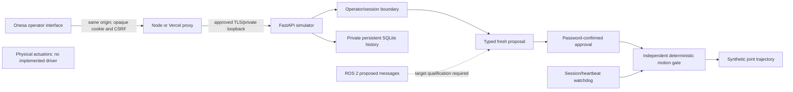

# Software simulation architecture

No model output or ROS message grants authority. Quintic smooth-step trajectories
are checked against synthetic SI-unit position/velocity/acceleration limits.
Proposals expire after 15 seconds; UUID reuse is rejected. Only one task runs, owned
by its approving session. Heartbeat loss, expiry, logout, cancel/stop, watchdog failure
or restart removes in-memory execution authority. Operator reset never resumes work.

Storage tables: sessions (hashed opaque token, CSRF, expiry, operator), tasks (ID,
operator, validated proposal, state/reason, timestamps and synthetic position), safety
(single durable stop latch). Sessions are revoked on process startup. No product
customer data or sibling database is used. Query results and UI text are bounded.

Auth/CSRF/ownership, limits, stale/future messages, completion, replay, connection
loss, cancellation, session expiry/revocation and restart are software tests. There
is no actual perception/model-policy path, connected ROS runtime or hardware safety
certification. Those dependencies must remain explicit, never silently simulated
inside a response labelled as a real robot or real model.

## Optional simulated edge telemetry

The separate `edge/simulation-agent.py` sends version-1 HTTPS telemetry outbound to
Render. It uses an independent per-device bearer token; the API stores only SHA256
of that token. Boot challenge, monotonic sequence, three-second freshness and ten
requests/second are enforced. Telemetry is explicitly synthetic and stopped, and
cannot create/approve/reset tasks or change the safety gate. Stale/disconnected
telemetry becomes `not_connected`. Bounded telemetry audit is in process memory;
it is not durable compliance logging. Task history remains in private SQLite.

No inbound edge listener, DDS exposure, tunnel, router change or automatic retry
is introduced. A failed agent stops and requires operator restart. There is no
cloud-to-edge motion/action transport: the cloud simulator retains its existing
independent motion gate, while a future real edge adapter must enforce its own
hardware-specific safety rules regardless of cloud state. Follow the separate
[release process](AUTOMATED_QUALIFICATION.md) before packaging/installing any adapter.
